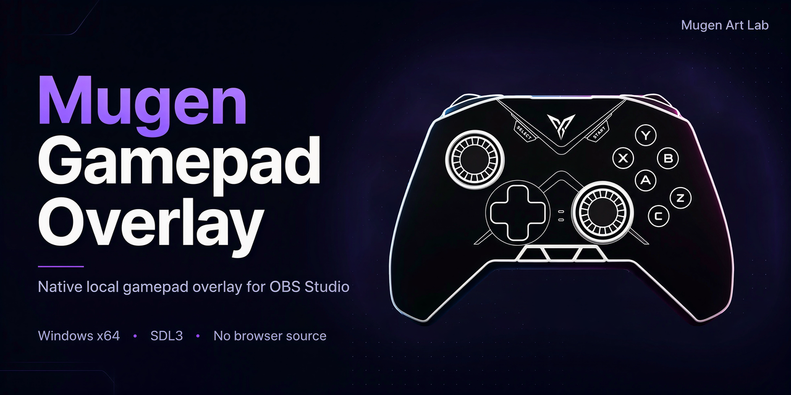
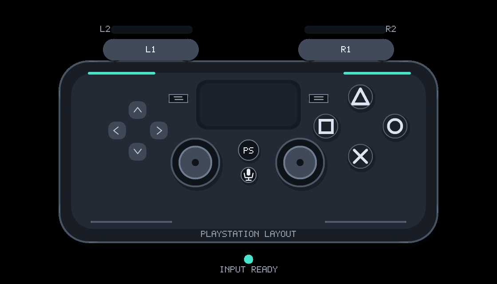
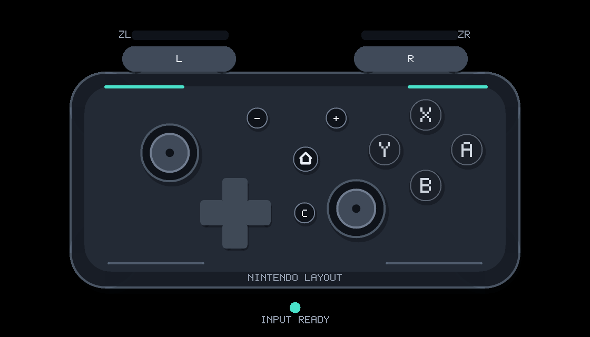

# Mugen Gamepad Overlay 0.8.2

[English README](README.md)

Локальный нативный источник отображения геймпада для OBS Studio под Windows.

Mugen Gamepad Overlay получает ввод через SDL3 и отрисовывает его прямо внутри OBS Studio. Для работы не нужны браузерный источник, сайт, WebSocket-сервер или передача ввода через интернет.

## Требования

- Windows 10 или Windows 11, x64;
- OBS Studio x64;
- контроллер, который SDL представляет как Gamepad.

## Скачать

Готовые файлы находятся во вложениях к последнему [релизу GitHub](https://github.com/Mugen-Art-Lab/Mugen-Gamepad-Overlay/releases). Для обычной OBS рекомендуется установщик. Также выпускаются стандартный ZIP и отдельный ZIP для portable OBS.

Автоматические архивы **Source code**, создаваемые GitHub, содержат исходники проекта, а не готовый к установке плагин.

## Что нового в 0.8.2

- Переработанный встроенный технический скин: аккуратные раскладки Xbox, PlayStation и Nintendo с автоматическим определением и ручным выбором.
- Необязательный **единый размер источника для всех скинов (1120×640)**: можно переключаться между встроенным скином, Input Overlay и GamepadViewer без изменения размеров источника. После первого включения один раз настройте масштаб на сцене OBS. **По умолчанию выключено**, чтобы сохранить старые настройки сцен.
- Исправлена загрузка в OBS Studio 33 с сохранением поддержки OBS Studio 32; обновлены форматы установки и метаданные версии.
- В плагине и установщике появился [официальный сайт Mugen Art Lab](https://mugenartlab.com/) для связи и информации о проекте.

## Основные возможности

- обновлённый технический скин с автоматическими раскладками контроллеров и ручным выбором оформления;
- локальные пресеты Input Overlay 5.x `JSON + PNG`;
- локальные скины GamepadViewer `CSS + SVG/PNG/JPEG` без браузера и JavaScript;
- стики, L3/R3, крестовина, плечи, аналоговые триггеры, Guide/Home, Capture/Misc и щелчок тачпада, когда контроллер их предоставляет;
- автоматические или ручные обозначения Xbox, PlayStation и Nintendo;
- живое обновление при подключении и отключении контроллеров в открытом окне свойств;
- расширенное переназначение кнопок и источников триггеров через SDL и Raw button/hat/axis;
- понятные двуязычные плашки ошибок при отсутствии или повреждении файлов скина;
- хоткей включения и выключения отдельного источника.

## Установка

### Установщик — рекомендуется

1. Полностью закройте OBS Studio.
2. Запустите `Mugen-Gamepad-Overlay-0.8.2-Windows-x64-Setup.exe`.
3. Запустите OBS Studio и добавьте источник **Mugen Gamepad Overlay**.

Установщик использует общую папку плагинов:

`C:\ProgramData\obs-studio\plugins\mugen-gamepad-overlay`

Ручная и portable-установка, обновление, удаление и диагностика описаны в [INSTALL-RU.md](INSTALL-RU.md).

## Источники скинов

Сторонние скины в проект не входят.

- GamepadViewer: вручную проверена коллекция [`frolovlife/gamepadviewer-skins`](https://github.com/frolovlife/gamepadviewer-skins).
- Input Overlay: проверены игровые пресеты Input Overlay 5.0.5.

Импортированная графика сохраняет собственные подписи и лицензии. Выбор обозначений в плагине меняет только встроенный скин и интерфейс переназначения.

Подробнее: [источники скинов](docs/SKIN-SOURCES-RU.md) и [совместимость GamepadViewer](docs/GAMEPADVIEWER-COMPATIBILITY-RU.md).

## Определение контроллеров

Автоматические подписи используют тип и раскладку, которые Windows и SDL сообщили плагину. Они могут отличаться от надписей на физическом корпусе из-за Bluetooth/XInput/DInput-режима, драйвера, Steam Input, DS4Windows, адаптера или виртуального контроллера.

На реальных устройствах проверены DualSense, Xbox-совместимые контроллеры, Flydigi Vader 2 Pro через USB и приёмник, 8BitDo M30 в нескольких режимах, SVEN X-PAD и Flipper Zero в режиме USB Game Controller. Специализированные Raw Joystick/HOTAS не входят в область 0.8.2.

Подробнее: [как плагин видит контроллер](docs/CONTROLLER-DETECTION-RU.md).

## Известные ограничения

- в 0.8.2 выпускается только Windows x64;
- Raw SDL Joystick/HOTAS не поддерживаются, если SDL не представляет устройство как Gamepad;
- произвольный браузерный CSS, JavaScript, HTML, удалённые ресурсы и CSS-анимации не гарантируются;
- старые Input Overlay INI и RetroArch CFG не поддерживаются;
- возможен физический щелчок тачпада, но не координаты касаний и жесты.

## Сборка из исходников

В репозитории хранится компактная часть проекта, относящаяся непосредственно к плагину. `BUILD_WINDOWS.cmd` создаёт игнорируемую рабочую папку на основе зафиксированной ревизии официального шаблона OBS, собирает конфигурацию Windows x64 Release и подготавливает установщик и ZIP-архивы. Ручной workflow **Windows Release Build** в GitHub Actions умеет выполнить такую же чистую релизную сборку удалённо и выдать временный artifact, не публикуя GitHub Release автоматически.

Требования и точный порядок описаны в [BUILDING-RU.md](docs/BUILDING-RU.md).

## Карта репозитория

- `src/` — нативный плагин и движки скинов;
- `data/` — локализация OBS и уведомления о сторонних компонентах;
- `installer/` — исходник установщика Inno Setup;
- `tools/` — скрипты рабочей папки, сборки и упаковки релиза;
- `docs/` — документация по совместимости, сборке и тестированию;
- `qa-tests/` — небольшие ручные тестовые стенды, которые не устанавливаются вместе с плагином.

## Конфиденциальность

Плагин считывает ввод локально. В нём нет телеметрии, рекламы, браузерного движка и автоматических или фоновых сетевых запросов. Кнопки в разделе **«О проекте»** открывают GitHub-репозиторий плагина или сайт Mugen Art Lab в системном браузере **только после нажатия**. Для работы оверлея сайт не нужен.

## Раскрытие использования ИИ

Mugen Gamepad Overlay разработан Mugen Art Lab при существенной помощи OpenAI ChatGPT в генерации кода, отладке, документации и подготовке релизных инструментов. Направление проекта, выбор функций, тестирование на реальных устройствах, визуальная оценка, проверка и ответственность за релиз остаются за Mugen Art Lab.

Подробнее: [AI-DISCLOSURE.md](AI-DISCLOSURE.md).

## Ошибки и поддержка

Для обратной связи, вопросов и предложений откройте [сайт Mugen Art Lab](https://mugenartlab.com/) и выберите **«Написать»**. Воспроизводимые технические ошибки также можно оформить через [Issues](https://github.com/Mugen-Art-Lab/Mugen-Gamepad-Overlay/issues); необходимые сведения перечислены в [SUPPORT.md](SUPPORT.md).

Mugen Gamepad Overlay остаётся бесплатным проектом с открытым исходным кодом. Исходники, релизы и баг-трекер находятся на GitHub.

## Лицензия

GPL-2.0-or-later. См. [LICENSE](LICENSE) и [data/THIRD-PARTY-NOTICES.txt](data/THIRD-PARTY-NOTICES.txt).

Mugen Gamepad Overlay — независимый сторонний плагин, не связанный с OBS Project и не одобренный им.
