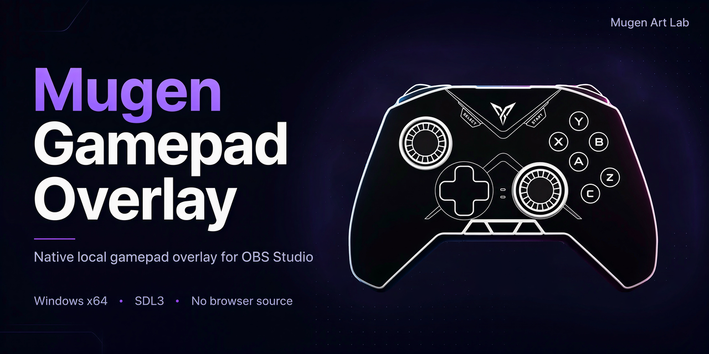
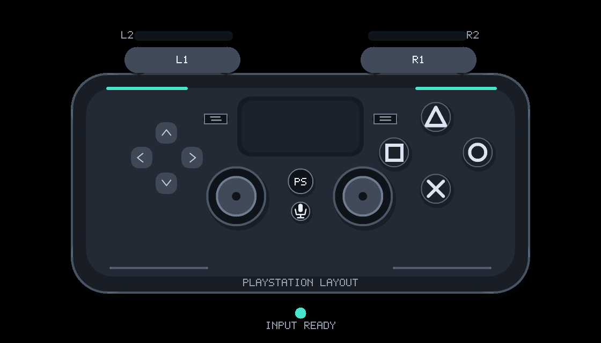
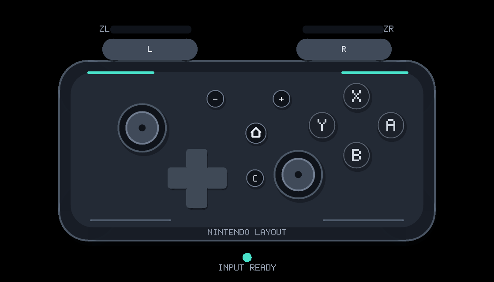

# Mugen Gamepad Overlay 0.8.2

[Русская версия](README-RU.md)

A local, native gamepad overlay source for OBS Studio on Windows.

Mugen Gamepad Overlay reads controller input through SDL3 and renders it directly inside OBS Studio. It does not require a browser source, website, WebSocket server, or network input relay.

## Requirements

- Windows 10 or Windows 11, x64;
- OBS Studio x64;
- a controller exposed by SDL as a Gamepad.

## Download

Use the files attached to the latest [GitHub Release](https://github.com/Mugen-Art-Lab/Mugen-Gamepad-Overlay/releases). The installer is recommended for a normal OBS Studio installation. Standard and portable ZIP packages are also provided.

The automatically generated **Source code** archives on GitHub contain the project source, not a ready-to-install plugin.

## What's new in 0.8.2

- Redesigned built-in technical skin with automatic Xbox-like, PlayStation-like and Nintendo-like layouts.
- Optional **one source size for all skins (1120×640)**: switch between built-in, Input Overlay and GamepadViewer artwork without changing the source dimensions. Enable it in source properties, then resize the source once in the OBS scene. It is **off by default** to preserve existing scenes.
- OBS Studio 33 compatibility fix without dropping OBS Studio 32 support; compatible package layouts and plugin version metadata.
- The official [Mugen Art Lab website](https://mugenartlab.com/) is linked from the plugin and installer for feedback and project information.

## Highlights

- Redesigned built-in technical skin with automatic controller-family layouts and manual selection.
- Local Input Overlay 5.x `JSON + PNG` presets.
- Local GamepadViewer `CSS + SVG/PNG/JPEG` skins rendered without a browser or JavaScript.
- Analog sticks, L3/R3, D-pad, shoulders, analog triggers, Guide/Home, Capture/Misc, and Touchpad click when exposed by the controller.
- Automatic or manual Xbox, PlayStation, and Nintendo face-button labels.
- Live controller hot-plug updates in an open properties window.
- Advanced button and trigger remapping with SDL and raw button/hat/axis sources.
- Clear bilingual error frames for missing or invalid skin files.
- Per-source enable/disable hotkey.

## Installation

### Installer — recommended

1. Close OBS Studio completely.
2. Run `Mugen-Gamepad-Overlay-0.8.2-Windows-x64-Setup.exe`.
3. Start OBS Studio and add a new **Mugen Gamepad Overlay** source.

The installer uses the all-users plugin directory:

`C:\ProgramData\obs-studio\plugins\mugen-gamepad-overlay`

For manual and portable installation, updating, removal, and troubleshooting, see [INSTALL.md](INSTALL.md).

## Skin sources

Third-party skins are not bundled with this project.

- GamepadViewer: the [`frolovlife/gamepadviewer-skins`](https://github.com/frolovlife/gamepadviewer-skins) collection was manually tested.
- Input Overlay: gamepad presets from Input Overlay 5.0.5 were tested.

Imported artwork keeps its own labels and licensing. The built-in label selector changes only the universal skin and the mapping interface.

More information: [skin sources](docs/SKIN-SOURCES.md) and [GamepadViewer compatibility](docs/GAMEPADVIEWER-COMPATIBILITY.md).

## Controller detection

Automatic labels follow the controller type and layout reported by Windows and SDL. They may differ from the markings on the physical controller because of Bluetooth/XInput/DInput modes, drivers, Steam Input, DS4Windows, adapters, or virtual controllers.

Verified real-device scenarios include DualSense, Xbox-compatible controllers, Flydigi Vader 2 Pro through USB and its receiver, 8BitDo M30 in multiple modes, SVEN X-PAD, and Flipper Zero in USB Game Controller mode. Specialized raw Joystick/HOTAS devices are outside the 0.8.2 scope.

More detail: [Controller detection and connection modes](docs/CONTROLLER-DETECTION.md).

## Known limits

- Windows x64 only in 0.8.2.
- Raw SDL Joystick/HOTAS devices are not supported unless SDL exposes them as a Gamepad.
- Arbitrary browser CSS, JavaScript, HTML, remote assets, and CSS animation are not guaranteed.
- Old Input Overlay INI presets and RetroArch CFG overlays are not supported.
- Touchpad click may be available; touch coordinates and gestures are not.

## Building from source

The repository keeps the plugin-specific source compact. `BUILD_WINDOWS.cmd` creates an ignored local workspace from a pinned revision of the official OBS plugin template, builds the Windows x64 Release configuration, and prepares the installer and ZIP packages. A manual **Windows Release Build** workflow in GitHub Actions can perform the same clean release build remotely and upload a temporary artifact without publishing a GitHub Release.

See [BUILDING.md](docs/BUILDING.md) for prerequisites and the exact process.

## Repository map

- `src/` — native plugin and skin renderers;
- `data/` — OBS localization and third-party notices;
- `installer/` — Inno Setup installer source;
- `tools/` — workspace, build, and release-packaging scripts;
- `docs/` — compatibility, build, and testing documentation;
- `qa-tests/` — small manual test fixtures; these are not installed with the plugin.

## Privacy

The plugin reads controller input locally. It does not include telemetry, advertisements, a browser engine, or automatic/background network requests. The **About** buttons open the plugin's GitHub repository or the Mugen Art Lab website in your system browser **only when clicked**. No website connection is required to use the overlay.

## AI development disclosure

Mugen Gamepad Overlay was developed by Mugen Art Lab with substantial assistance from OpenAI ChatGPT for code generation, debugging, documentation, and release tooling. Project direction, feature decisions, real-device testing, visual evaluation, validation, and release responsibility remain with Mugen Art Lab.

See [AI-DISCLOSURE.md](AI-DISCLOSURE.md).

## Support and issues

For feedback, questions and ideas, visit [Mugen Art Lab](https://mugenartlab.com/) and choose **Write**. Reproducible technical bugs can also be reported through the [issue tracker](https://github.com/Mugen-Art-Lab/Mugen-Gamepad-Overlay/issues); see [SUPPORT.md](SUPPORT.md) for the information to include.

Mugen Gamepad Overlay is free and open source. Its source code, releases and issue tracker remain available on GitHub.

## License

GPL-2.0-or-later. See [LICENSE](LICENSE) and [data/THIRD-PARTY-NOTICES.txt](data/THIRD-PARTY-NOTICES.txt).

Mugen Gamepad Overlay is an independent third-party plugin and is not affiliated with or endorsed by the OBS Project.
